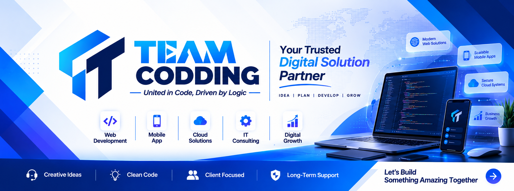

  

<!-- <h3 align="center">A passionate DevOps Engineer From India. I work in Corporate IT Sector and in my free time I make YouTube videos at https://www.youtube.com/@devopsshack</h3> -->

<h3>💫 About Me:</h3>
Welcome to my GitHub Portfolio!  I'm Naeem Islam, a passionate professional designer with 3years of industry experience. Proficient in [Figma, HTML, Modern CSS, JavaScript, React, Ajax, PHP, Laravel], I continuously explore new trends and techniques to deliver designs that are both contemporary and timeless.  Thank you. Looking forward to working with you.

## 💻 Tech Stack:
                      

---

<!-- Proudly created with GPRM ( https://gprm.itsvg.in ) -->
